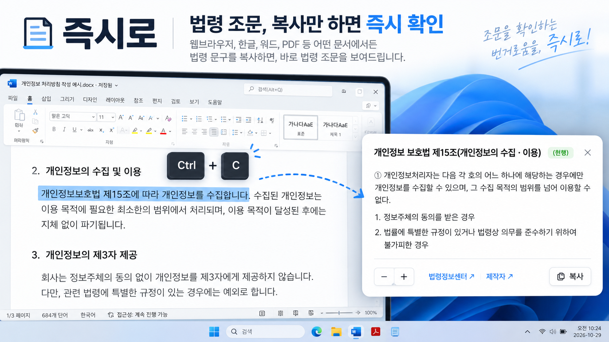

# 즉시로 — 법령 조문을 가장 빠르고 간편하게 확인하세요
# Immediately Law — The world's fastest law check, ever.

<p align="center">
  <a href="https://youtu.be/rZUceBYTzhg" target="_blank" rel="noopener">
    
  </a>
</p>

<p align="center">
  
  
  
  
  
  
  
  
  
  
  
  
  
</p>

**즉시로**(Immediately Law)는 대한민국 법령을 가장 빠르게 확인할 수 있는 프로그램입니다.

텍스트로 제시되는 법령을 복사(Ctrl + C)하면 **화면 오른쪽 아래**에 조문이 바로 출력됩니다.

> "개인정보 보호법 제15조"라고만 안내되어 직접 해당 조문을 찾아봐야 했던 번거로움,
> **이제 즉시로가 끝내드립니다.** 안내된 법령을 복사(Ctrl + C)만 하세요.
> 조문은 즉시로가 찾아드릴게요!

- **사용환경**: Windows 10/11 (64-bit)
- **속도**: 조문 열람은 전부 로컬 DB를 색인하여 즉시 보여집니다.
- **데이터**: 국가법령정보센터(법제처) OPEN API, 전체 현행 법령 + 시행령 + 시행규칙
  (약 5,600종 · 20만 조문)을 매일 자동 갱신
- **온/오프라인**: 오프라인에서도 동작하며, 온라인 상태에서는 실시간으로 현행 법령과 일치하는지를 확인하는 기능이 제공됩니다.

---

## 설치 방법

### 다운로드 (둘 중 편한 곳)

| 버전 | GitHub Releases | GitLab 직접 다운로드 |
|---|---|---|
| 온라인(앱만) | [Releases](https://github.com/nazgregory/ImmediatelyLaw/releases) | [ImmediatelyLaw-online.zip](https://gitlab.aigov.go.kr/irize/immediatelylaw/-/raw/download/ImmediatelyLaw-online.zip) |
| 오프라인(앱+데이터) | [Releases](https://github.com/nazgregory/ImmediatelyLaw/releases) | [ImmediatelyLaw-offline.zip](https://gitlab.aigov.go.kr/irize/immediatelylaw/-/raw/download/ImmediatelyLaw-offline.zip) |

> GitHub가 가장 최신이며, GitLab은 **`download` 브랜치**에 같은 설치 zip을 두어
> 릴리즈 화면 없이도 파일을 바로 받을 수 있습니다. 링크가 열리지 않으면 저장소에서
> 브랜치를 `download`로 바꾼 뒤 파일의 [Raw]를 누르세요.

zip을 받아 압축을 풉니다. 

설치 프로그램이 필요 없는 포터블 앱입니다. 

`ImmediatelyLaw.exe`를 실행하면 트레이(오른쪽 아래)에 `법` 아이콘이 생성됩니다.

### 인터넷 사용 가능 PC (온라인)
1. `ImmediatelyLaw-online.zip` 다운로드 → 압축 해제 → `ImmediatelyLaw.exe` 실행
2. 첫 실행 시 법령 데이터(약 20MB)를 자동 다운로드합니다 (1회, 1분 이내)
3. 조문을 복사(Ctrl + C)하면 오른쪽 아래에 카드가 뜹니다

### 인터넷 사용 불가 PC (오프라인)
1. 다른 PC에서 `ImmediatelyLaw-offline.zip`(앱 + 데이터 동봉)을 받아 전달
2. 압축 해제 → `ImmediatelyLaw.exe` 실행 — 동봉된 데이터가 즉시 적용됩니다
3. 조문을 복사(Ctrl + C)하면 오른쪽 아래에 카드가 뜹니다
   - 이후 인터넷이 되는 날 자동으로 최신 법령을 확인합니다

### Windows의 PC 보호 (파란 경고창)
1. Windows의 PC 보호 : **Microsoft Defender SmartScreen에서 인식할 수 없는 앱의 시작을 차단했습니다. 이 앱을 실행하면 PC가 위험에 노출될 수 있습니다.** 라는 메시지가 발견되면, 추가정보 > **실행**을 클릭합니다.
2. 이 프로그램의 소스코드는 공개되어 있어 누구나 안전성을 검증할 수 있습니다.
3.  반드시 공식 저장소(https://github.com/nazgregory/ImmediatelyLaw/releases)에서 다운로드 한 파일을 사용하세요.

---

## 사용 방법

| 동작 | 방법 |
|---|---|
| 조문 표시 | `형법 제23조`, `「개인정보 보호법」 제13조`, `같은 법 제15조` 등 **복사만 하면 끝** |
| 법+시행령 함께 | `「도서관법」 제33조 및 같은 법 시행령 제19조` → 두 조문을 구분선으로 **이어서 표시** |
| 같은 법 맥락 | 이어서 `같은 법 시행령 제19조`, `같은 법 제5조`만 복사해도 **직전 조회한 법령** 기준으로 해석 |
| 헌법도 기본 법률 | `헌법 제11조`, `대한민국헌법 제31조` 모두 조회 — `헌법`은 **대한민국헌법**으로 자동 해석 |
| 직접 조회 | **Ctrl + Alt + L** 또는 트레이 클릭 → 입력 창에 `민법 750` 입력 |
| 재복사 | **[복사]** 버튼 → 조문 원문을 클립보드로 저장 |
| 글자 크기 | 좌하단 **[-] [+]** 버튼(장·절·본문 동일) |
| 법령정보센터 | **[법령정보센터 ↗]** 링크 클릭 → [www.law.go.kr](https://www.law.go.kr/) 이동 |
| 제작자 | 서초구청 홍성민 주무관 : **[제작자 ↗]** 링크 → 제작자 GitHub 페이지 이동 |
| 닫기 | 우상단 ✕ / (2초 이내) ESC 두 번 / 카드 바깥 클릭 / 자동 숨김(기본 30초, 설정에서 변경 가능) |

장·절 표기와 조문 본문은 맑은 고딕 같은 크기로 표시되며, 상태는 배지로 표시됩니다:

**현행** 초록 배지 = 법제처 현행 법령과 일치(실시간 온라인 검증)

**확인** 주황 배지 = 개정 여부 확인 필요(실시간 현행 법령과 로컬 조문 데이터 불일치)

**오프라인** 배지 = 네트워크 없이 로컬 데이터 기준

### 옵션 (트레이 우클릭 › 설정)
- **데이터**: 배포 주소(기본값 내장 — 수정 불필요), 지금 업데이트 확인
- **자치법규**: 자치법규(hwp, hwpx, doc, pdf, txt, md 등) 파일 추가, 변경, 삭제
- **API 키**: [국가법령정보 공동활용](https://open.law.go.kr/LSO/main.do)에서 발급한
  OC 인증키 입력 시 **미보유 법령 즉시 수집 + 법제처 실시간 검증**이 추가됩니다.
  키는 Windows DPAPI로 암호화 저장되어 이 PC의 사용자만 열 수 있습니다. 없어도 전부 동작합니다.
- **오버레이**: 모드(시스템/라이트/다크), 카드 너비, 화면 위치(4곳), 글자 크기(pt 수치 지정),
  자동 숨김 시간, 현행 여부 실시간 검증
- **일반**: 단축키 사용, 클립보드 감시 일시정지, Windows 시작 시 실행(기본 값), 새 버전 알림·자동 업데이트(기본 켬 — 새 릴리스가 나오면 안내 후 사용자가 동의할 때만 적용)
- **정보**: 제작자·연락처·소스 저장소·데이터 출처 안내

---

## 자치법규 지원

작업 표시줄 > 시스템 트레이 > 즉시로(우클릭) > 설정 > 자치법규 탭에서 조례, 규칙, 훈령 등의 추가 자료를 등록, 변경, 삭제 할 수 있습니다

조례·규칙 등 자치법규도 함께 찾고 싶다면 필요한 파일을
`%APPDATA%\immediatelylaw\data\regulations\` 폴더에 넣기만 하면 됩니다
(시작 시 자동 등록, 삭제 시 자동 정리).

- 지원 형식: `.hwpx` `.hwp` `.doc` `.docx` `.pdf` `.rtf` `.txt` `.md`
- 가장 간단한 형식 — 첫 줄에 조례명, 그 아래 `제N조(제목) …` 본문
  ```
  평창군 위원회 설립 및 지원 조례
  제1조(목적) 이 조례는 …의 설립 및 활동지원에 관한 사항을 규정함을 목적으로 한다.
  제2조(다른 법령과의 관계) …
  ```
- 법제처 국가법령정보센터에서 내려받은 `.hwp/.hwpx/.doc/.pdf` 파일도 그대로 인식됩니다
- 표시는 카드에 `[자치]` 배지로 구분됩니다

---

## 업데이트 원리

앱은 데이터 저장소 [immediatelylaw-data](https://github.com/nazgregory/immediatelylaw-data)
`dist` 브랜치를 주기적으로(8시간 + 시작 시) 확인합니다. 새 버전이 있으면
새 스냅샷을 다운로드해 SHA-256 검증 후 교체합니다. 다운로드는 HTTPS로만
이루어지며 검증 실패 시 적용되지 않습니다. 모든 최신화는 자동화 되어 있습니다.

데이터 저장소를 직접 운영(매일 최신화)하는 방법은
[데이터 저장소 운영 가이드](docs/DATA_REPO.md)를 참고하세요.

---

## 소스에서 실행 (개발자)

```
git clone https://github.com/nazgregory/ImmediatelyLaw.git
cd ImmediatelyLaw
pip install PySide6 requests pypdf defusedxml
python run.py            # 창 없이 실행: pythonw run.py
```

- 패키징: `pyinstaller ImmediatelyLaw.spec` → `dist/ImmediatelyLaw/`
- 데이터 발행: `docs/DATA_REPO.md`
- 데이터 경로: 개발 중 `data/`, 설치본 `%APPDATA%\immediatelylaw\data\`
  (환경변수 `IMMEDIATELYLAW_DATA_DIR`로 변경 가능)
- 코드 구조: `immediatelylaw/` 앱 본체(watcher·overlay·resolver·db·workers…),
  `tools/` 데이터 수집·배포(publisher·push_dist)

## 의존 라이브러리 및 라이선스

이 프로그램이 사용하는 오픈소스 라이브러리와 라이선스입니다. (배지는 현재 릴리즈 동봉 버전)


| 라이브러리 | 동봉 버전 | 용도 | 라이선스 |
|---|---|---|---|
| Python | 3.15 (exe에 동봉) | 런타임 인터프리터 | PSF |
| PySide6 (Qt for Python) | 6.12.0 | GUI — 트레이, 오버레이 카드, 조회·설정 창 | LGPL-3.0 |
| requests | 2.34.2 | HTTPS 데이터 다운로드·법령 API 호출 | Apache-2.0 |
| pypdf | 6.21.3 | 자치법규 PDF 텍스트 추출 | BSD-3-Clause |
| defusedxml | 0.7.1 | HWPX/DOCX 등 XML 안전 파싱 | PSF |

- 프로그램 본체는 MIT 라이선스입니다.
- Qt(PySide6)는 LGPL이므로, 재링크가 가능한 onedir(폴더형 배포) 방식으로 배포하며
  본 저장소의 소스로 교체·재빌드가 가능합니다.

---

## 라이선스 및 데이터 고지

- **프로그램**: [MIT License](LICENSE) — 자유롭게 사용·복제·수정·재배포 가능
- **법령 데이터**: 국가법령정보센터(법제처·법령정보원) 공공누리 출처 표기 조건 무료 개방.
  법령의 효력 판정은 공식 원문이 기준이며, 즉시로의 표시는 참고용입니다.
- 이 프로그램의 모든 소스코드는 공개됩니다. 누구나 수정 및 재배포가 가능합니다. 
- 재배포시에는 반드시 원작자 정보를 함께 표시해주세요.
